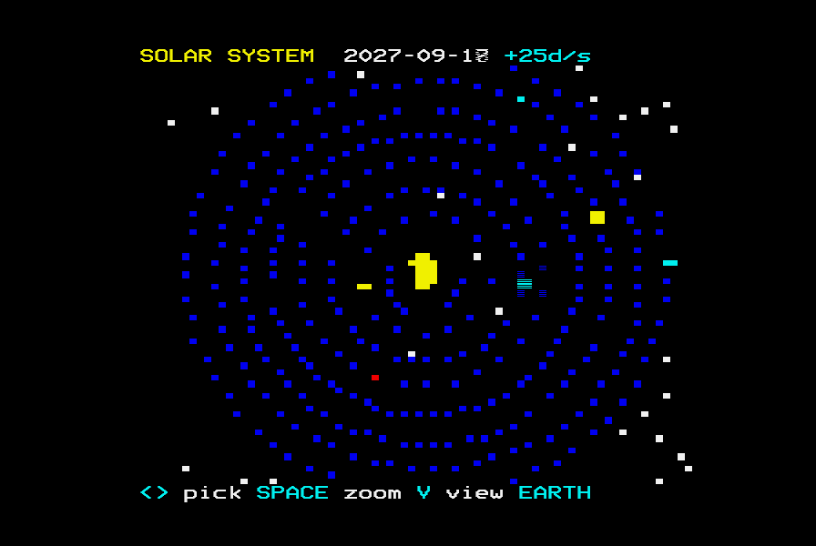
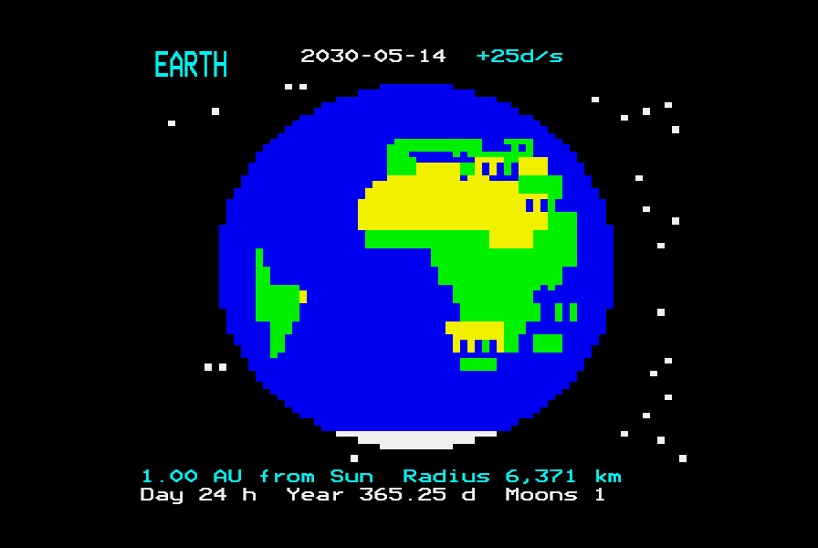
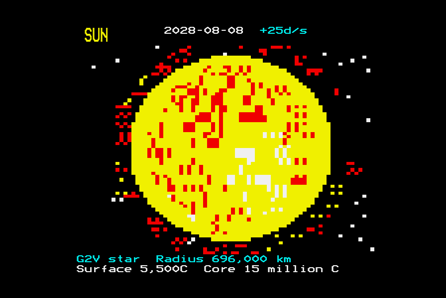
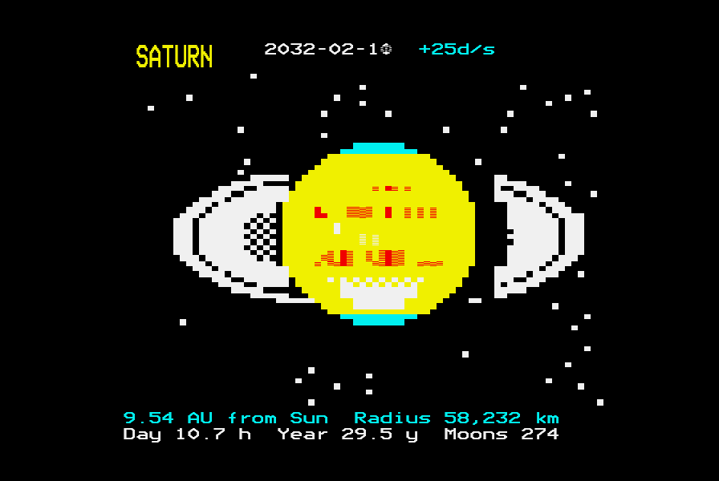
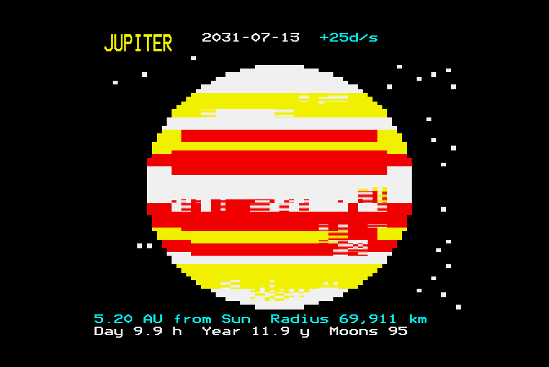
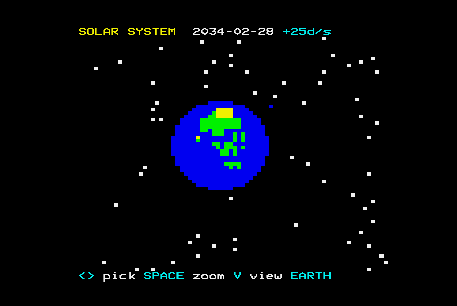

# BEEB-SOLAR

**The solar system on a 1981 BBC Micro Model B, in Mode 7 teletext graphics.**
Pure 6502 machine code: the eight planets move on their real orbits (starting on 18 November 2026), and picking one eases the view in
to a spinning, textured globe. Earth's continents come from Natural Earth's coastlines; the Sun has granulation, sunspots and
a flickering corona; Saturn has its rings, behind and in front of the globe.

**Play it in the browser: https://bobstrogg.github.io/beeb-solar/** (jsbeeb, with touch buttons for phones)

| | | |
|---|---|---|
|  |  |  |
| whole system (log scale) | Earth | the Sun |
|  |  |  |
| Saturn | Jupiter | zooming out from Earth |

More: [inner planets](docs/images/inner.png), [Mercury](docs/images/mercury.png), [Venus](docs/images/venus.png),
[Mars](docs/images/mars.png), [Uranus](docs/images/uranus.png), [Neptune](docs/images/neptune.png), [the Moon](docs/images/moon.png).

## Running it

* **Browser:** the link above, or `web/` served locally.
* **Real BBC Micro / emulator:** `discs/beeb-solar.ssd` (SHIFT+BREAK, or `*RUN SOLAR`). Model B, OS 1.20, DFS or MMFS.
* **MMFS (MicroSD in the user port):** `discs/BEEB-SOLAR.MMB.zip` holds an MMB image with the game in slot 0 (boots with
  SHIFT+BREAK) plus the .ssd to add to your own image with MMB_Utils (`dput_ssd.pl`).

## Controls

| key | |
|---|---|
| ← → | pick a body (in a close-up: fly out and in to the next one) |
| SPACE / RETURN | zoom in to the picked body / back out (pressing again mid-zoom turns round) |
| 1-8, S or 0, M or 9 | fly straight to a planet, the Sun or the Moon |
| < > (or , . ↓ ↑) | time slower / faster: 0.8, 1.6 … 25 (default) … 800 days a second |
| R | time backwards / forwards |
| P | pause time (the globes stop turning too) |
| N | back to the start date |
| V | whole solar system (log scale) / inner planets (true scale) |
| T | tilt the orbits (view from an angle) |
| O | orbits on / off |
| I | header and facts on / off (graphics use all 25 rows) |
| F | frame rate on / off |
| Q / ESCAPE | quit to BASIC (`*RUN SOLAR` to start again) |

The web page has buttons for all of these; they send the real BBC keys into jsbeeb, and the page never zooms on a double tap.

## Frame rates (Model B, 2 MHz, measured in jsbeeb by `test/boot.mjs`)

| view | fps | | view | fps |
|---|---|---|---|---|
| whole system | 25 | | Mars | 12.6 |
| inner planets | 25 | | Jupiter | 12.6 |
| the Sun | 11 | | Saturn (with rings) | 16.6 |
| Mercury | 12.4 | | Uranus | 12.4 |
| Venus | 12.4 | | Neptune | 12.4 |
| Earth | 12.4 | | the Moon | 12.4 |
| a zoom in or out | 7-9 | | | |

Everything is double-buffered (no tearing): the Model B's Mode 7 screen can be moved to &3C00 as well as &7C00, so each
frame is drawn off screen and the CRTC start address is flipped at the next vertical sync.

## How it works

**Orbits.** `tools/gen_tables.py` takes JPL's approximate Keplerian elements (Standish, valid 1800-2050) and solves Kepler's
equation for 64 positions per planet at equal steps of mean anomaly, scaled for each view: the whole system maps log(distance)
piecewise so the semi-major axes land on evenly spaced rings; the inner view is to scale (18.5 pixels per AU). On the Beeb
each planet has a 32-bit mean-anomaly accumulator advanced every vsync by its mean motion × the time speed; its top 6 bits
pick the table entry and the next 8 interpolate to the next one, so planets move at their true, varying speeds along
eccentric orbits. The date (Gregorian; it starts on 18 November 2026, `START` in tools/gen_tables.py) is kept incrementally. The stars and dotted orbits
are drawn once and cached; each frame copies them back and adds the planets.

**Zoom.** One parameter (0-255, eased with smoothstep) drives everything: the scale is 2^(e × log2(final size / system size)),
taken from a 64-entry 2^x table, and the origin slides from the Sun to the target, so the whole system grows around the
planet until it fills the screen. A multiply table is rebuilt per frame so every point transforms with two lookups. Small
targets are flat discs; above 4 pixels radius it becomes the textured globe, its texture read from disc when the zoom starts.

**Globes.** Each body has a 128×64 equirectangular texture of up to 8 "materials", each with a teletext colour and an optional
dither probability (applied while unpacking, so the Sun's granulation and Mercury's grey are random noise). For a radius R the
6502 builds, per half-row, the longitude offset (asin(x/w)) of every pixel and the texture row (latitude); the lower half
mirrors the upper. A self-modified sampler then reads six texels per teletext cell (rotation added per texture row, which
gives the Sun its differential rotation), builds the sextant character and picks the cell's colour. Teletext allows one
foreground and one background colour per cell and colour changes cost a cell, so each row of a globe is laid out as:
limb cells in the row's base colour on black, "new background" (the base colour, e.g. ocean blue), the texture as foreground
detail over that background, two solid cells and "black background". Hold graphics keeps the colour-change cells filled.
Once the zoom has stopped, only the texture is resampled each frame.

**Textures** (`tools/textures.py`, previews in `build/tex/`): Earth from Natural Earth 1:50m land, desert regions and glaciers
(public domain) plus polar ice; Mars's albedo features and polar caps; Jupiter's belts, zones, festoons and Great Red Spot;
Saturn's belts; cloudy Venus; cratered Mercury and the Moon (maria, Tycho and its rays); Uranus and Neptune (with the Great
Dark Spot). They are run-length coded (5.3K for all ten) and loaded on demand.

**Saturn's rings** are three elliptical bands (C, B, A with the Cassini division) tilted ~25°. Their far half is drawn only
outside the globe, the near half also over it, never over its edge cells.

**The Sun's corona** is a ring of random red and yellow pixels beyond the limb, redrawn every other frame.

**Keys** are read by scanning the keyboard hardware in the vsync event, latched so short presses are never missed.

## Building

```
git clone --recursive https://github.com/BobStrogg/beeb-solar && cd beeb-solar
pip install numpy pillow pyshp        # pyshp only to rebuild Earth from Natural Earth (tools/get_data.sh)
cd vendor/beebasm-src && cmake . && make && cd ../..   # or put a beebasm binary at vendor/beebasm-src/beebasm
./build.sh                            # build/beeb-solar.ssd
./tools/make_mmb.sh                   # build/BEEB-SOLAR.MMB.zip
(cd vendor/jsbeeb && npm ci)
node test/boot.mjs                    # headless: boot, every body, fps, quit to BASIC, restart; screenshots
node test/browser.mjs [url]           # the web page in Chrome, and a phone-sized touch check
```

Memory (Model B, PAGE &1900): code and low tables &1900-&3BFF, second screen &3C00, texture &4000-&5FFF, cell buffers
&6000-&67FF, sphere tables &6800, high tables (file SOLARD) and variables to &7BFF, names and facts (file SOLART) in BASIC's
workspace at &0480 (cleared again on exit).

## Licence

MIT (see LICENSE). jsbeeb (vendor/jsbeeb, and its build in web/jsbeeb) is GPL-3.0 by Matt Godbolt and contributors;
BeebAsm is GPL-3.0; MMB_Utils by Stephen Harris. Natural Earth data is public domain.
